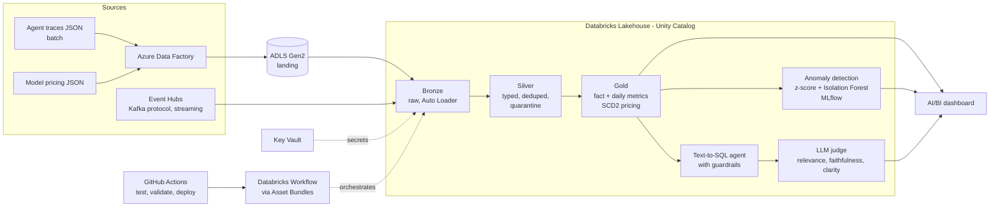

# AgentOps Lakehouse

**Observability, cost (FinOps) and quality monitoring for AI agents, built end to end on Azure and Databricks.**

AI agents are expensive and fail quietly: a prompt grows, a cost line spikes, an answer is confidently wrong, and nobody notices until the bill arrives. AgentOps Lakehouse ingests agent traces, models them in a medallion lakehouse, detects cost anomalies with ML, evaluates answer quality with an LLM judge, and ships through CI/CD.


*Databricks AI/BI dashboard: the support-bot's cost spike (top left), its root cause, a 4x jump in prompt size (top right), the anomalies the ML model flagged, and agent answer quality scored by an LLM judge.*

## Architecture



## What it demonstrates

| Area | What was built |
|---|---|
| Ingestion | Azure Data Factory batch copy to ADLS Gen2; Event Hubs streaming read through the Kafka protocol |
| Lakehouse | Bronze, silver, gold medallion on Unity Catalog; Auto Loader; Delta MERGE; dedupe; quarantine table for bad rows; schema evolution |
| Modeling | SCD Type 2 pricing dimension with point-in-time join, so historical cost uses the price in force at the time |
| Orchestration | Databricks Workflows job (bronze, silver, gold) defined as code with Asset Bundles |
| ML | Robust z-score baseline vs Isolation Forest, tracked in MLflow, model registered in Unity Catalog |
| GenAI | Text-to-SQL agent with code-enforced guardrails; LLM-as-judge evaluation validated against human labels |
| DevOps | Git branching and PRs, pytest, GitHub Actions (test and validate on PR, deploy only on merge to main) |
| Security | Secrets in Key Vault through a Databricks secret scope; RBAC; no keys in code |

## Results

- **Data quality:** 14,140 raw events in, 14,000 unique, 13,789 in silver, 211 quarantined with reasons. Zero null costs in gold.
- **Anomaly detection:** the z-score baseline flagged 4 agent-days (precision 0.25, recall 1.00). Isolation Forest flagged 2 (precision 0.50, recall 1.00): same recall, half the false alarms.
- **LLM judge:** the first rubric was too lenient and passed a fabricated answer. After tightening it, agreement with human labels rose from 82% to 91%.
- **Agent quality:** after fixing failures the judge found, the agent's pass rate rose from 78% to 89% (8 of 9 questions).
- **Deployment:** CI deploy is idempotent (0 created, 0 changed, 1 unchanged on a repeat run).

## Repository layout

```
agent/                 text-to-SQL guardrails and the synthetic trace generator
databricks/notebooks/  bronze, silver, gold and streaming notebooks
ml/                    anomaly detection and agent / judge notebooks
tests/                 pytest tests for the guardrails
docs/                  per-phase notes and the dashboard screenshot
.github/workflows/     CI/CD pipeline
databricks.yml         Asset Bundle: the workflow job as code
```

## Run the tests locally

```bash
python3 -m venv .venv
source .venv/bin/activate
pip install -r requirements-dev.txt
python -m pytest -q
```

The 8 guardrail tests check that the text-to-SQL agent only reads the four allowed gold tables and rejects anything that writes or alters data.

## Deploy it yourself

The Azure resources below are created by hand (there is no infrastructure-as-code yet). The Databricks pipeline itself is deployed from this repo with Asset Bundles.

**Prerequisites:** an Azure subscription (a free trial works), the [Databricks CLI](https://docs.databricks.com/dev-tools/cli/install.html), Python 3.11 or newer, and a GitHub account for CI.

1. **Azure foundation.** Create a resource group (`rg-agentops-dev`, East US). Inside it, create an ADLS Gen2 storage account (hierarchical namespace on, LRS, Hot tier) with four containers: `landing`, `bronze`, `silver` and `gold`. Create a Key Vault with the RBAC permission model. Details are in [Phase 1](docs/phase-1-setup.md).
2. **Generate the data.** Run `python agent/generate_traces.py`. It writes 7 daily JSONL trace files and a model pricing CSV, with planted duplicates, nulls, late events, a schema change and a cost spike. Upload the trace files to `landing/traces/` and the pricing file to `landing/pricing/`.
3. **Batch ingestion.** Create an Azure Data Factory with a system-assigned managed identity and give it the Storage Blob Data Contributor role on the storage account. Recreate the linked service, dataset, pipeline and trigger from the JSON files in [`adf/`](adf/) (use the `{}` code view in ADF Studio). Run `pl_ingest_landing_to_bronze` once with `sourceFolder` set to `traces` and once set to `pricing`. Files land unchanged in `bronze/raw/`. Details are in [Phase 2](docs/phase-2-ingestion.md).
4. **Databricks and Unity Catalog.** Create an Azure Databricks workspace in the same resource group. Create an access connector (managed identity) with access to the storage account, a storage credential, and external locations. Then create a catalog `dbw_agentops` with schemas `bronze`, `silver` and `gold`, each with a managed location in ADLS. Details are in [Phase 3](docs/phase-3-databricks.md). A free-trial subscription allows 4 cores, so the bundle uses a single-node cluster.
5. **Deploy the pipeline.** In `databricks.yml`, set `workspace.host` to your workspace URL, then:

   ```bash
   databricks auth login --host <your-workspace-url>
   databricks bundle validate
   databricks bundle deploy
   databricks bundle run agentops_daily_pipeline
   ```

   The job runs `bronze_ingest`, then `silver_traces`, then `gold_metrics`. Its daily schedule is created paused. Expected result: 14,140 bronze rows, 14,000 unique traces, 13,789 silver rows, 211 quarantined, and a gold fact table with no null costs.
6. **Optional: streaming.** Create an Event Hubs namespace (Standard tier, which includes the Kafka endpoint) with an event hub `agent-traces` (2 partitions), store its connection string in Key Vault, and back a Databricks secret scope with that vault. Then run notebooks `04_stream_producer` and `05_stream_ingest`. Event Hubs bills by the hour, so delete it afterwards. Details are in [Phase 4](docs/phase-4-streaming.md).
7. **Optional: ML, agent and dashboard.** Import `ml/06_anomaly_detection.ipynb` and `ml/07_ask_the_lakehouse.ipynb` into the workspace and run them after the gold tables exist. They need a hosted model endpoint (the project used `system.ai.gpt-oss-120b`; availability varies by workspace). The dashboard queries are in [`docs/dashboard-datasets.sql`](docs/dashboard-datasets.sql).
8. **CI/CD.** In your GitHub repo, add the secrets `DATABRICKS_HOST` and `DATABRICKS_TOKEN`. Pull requests then run the tests and `databricks bundle validate`; a merge to `main` also deploys the bundle. For anything beyond a demo, use a service principal instead of a personal access token.
9. **Tear down.** Delete the Databricks workspace first (its managed resource group goes with it), then the resource group, then revoke the access token and delete the GitHub secrets.

## Build log

- [x] Phase 1: Azure foundation (resource group, ADLS Gen2, Key Vault)
- [x] Phase 2: batch ingestion with Data Factory
- [x] Phase 3: Databricks medallion (bronze, silver, gold)
- [x] Phase 4: streaming with Event Hubs
- [x] Phase 5: orchestration with Workflows
- [x] Phase 6: anomaly detection, text-to-SQL agent, LLM judge
- [x] Phase 7: CI/CD with GitHub Actions and Asset Bundles
- [x] Phase 8: dashboard and write-up

Detailed notes per phase are in [`docs/`](docs/).

## Known limitations

- CI authenticates with a personal access token; production should use a service principal with OIDC.
- Only a `dev` bundle target exists.
- The streaming task is not in the bundle, because Event Hubs was deleted after the phase to stop billing.
- The judge uses the same model family as the agent, which risks self-preference bias; the labeled set is small (11 examples).
- The judge still misses one case (a p95 question where the data granularity cannot answer it).
- Data is synthetic, generated with planted failures (duplicates, nulls, late events, schema drift, a cost spike) so results can be checked against known ground truth.

## Cost note

Built on an Azure free trial. Event Hubs (Standard tier, billed hourly) was created for the streaming phase and deleted afterwards. Compute was a single-node cluster within the free-trial core quota, and the dashboard used a serverless SQL warehouse that bills only while running.
