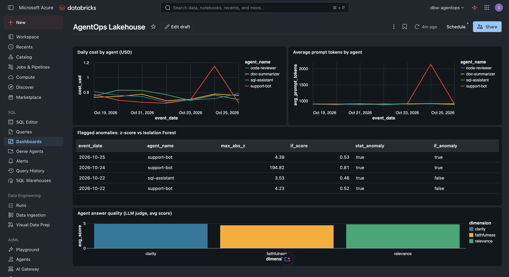
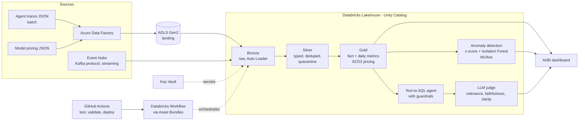

# AgentOps Lakehouse

**Observability, cost (FinOps) and quality monitoring for AI agents, built end to end on Azure and Databricks.**

AI agents are expensive and fail quietly: a prompt grows, a cost line spikes, an answer is confidently wrong, and nobody notices until the bill arrives. AgentOps Lakehouse ingests agent traces, models them in a medallion lakehouse, detects cost anomalies with ML, evaluates answer quality with an LLM judge, and ships through CI/CD.



*Databricks AI/BI dashboard: the support-bot's cost spike (top left), its root cause, a 4x jump in prompt size (top right), the anomalies the ML model flagged, and agent answer quality scored by an LLM judge.*

## Architecture



## What it demonstrates

| Area | What was built |
|---|---|
| Ingestion | Azure Data Factory batch copy to ADLS Gen2; Event Hubs streaming read through the Kafka protocol |
| Lakehouse | Bronze, silver, gold medallion on Unity Catalog; Auto Loader; Delta MERGE; dedupe; quarantine table for bad rows; schema evolution |
| Modeling | SCD Type 2 pricing dimension with point-in-time join, so historical cost uses the price in force at the time |
| Orchestration | Databricks Workflows job (bronze, silver, gold) defined as code with Asset Bundles |
| ML | Robust z-score baseline vs Isolation Forest, tracked in MLflow, model registered in Unity Catalog |
| GenAI | Text-to-SQL agent with code-enforced guardrails; LLM-as-judge evaluation validated against human labels |
| DevOps | Git branching and PRs, pytest, GitHub Actions (test and validate on PR, deploy only on merge to main) |
| Security | Secrets in Key Vault through a Databricks secret scope; RBAC; no keys in code |

## Results

- **Data quality:** 14,140 raw events in, 14,000 unique, 13,789 in silver, 211 quarantined with reasons. Zero null costs in gold.
- **Anomaly detection:** the z-score baseline flagged 4 agent-days (precision 0.25, recall 1.00). Isolation Forest flagged 2 (precision 0.50, recall 1.00): same recall, half the false alarms.
- **LLM judge:** the first rubric was too lenient and passed a fabricated answer. After tightening it, agreement with human labels rose from 82% to 91%.
- **Agent quality:** after fixing failures the judge found, the agent's pass rate rose from 78% to 89% (8 of 9 questions).
- **Deployment:** CI deploy is idempotent (0 created, 0 changed, 1 unchanged on a repeat run).

## Repository layout

```
agent/                 text-to-SQL guardrails and the synthetic trace generator
databricks/notebooks/  bronze, silver, gold and streaming notebooks
ml/                    anomaly detection and agent / judge notebooks
tests/                 pytest tests for the guardrails
docs/                  per-phase notes and the dashboard screenshot
.github/workflows/     CI/CD pipeline
databricks.yml         Asset Bundle: the workflow job as code
```

## Build log

- [x] Phase 1: Azure foundation (resource group, ADLS Gen2, Key Vault)
- [x] Phase 2: batch ingestion with Data Factory
- [x] Phase 3: Databricks medallion (bronze, silver, gold)
- [x] Phase 4: streaming with Event Hubs
- [x] Phase 5: orchestration with Workflows
- [x] Phase 6: anomaly detection, text-to-SQL agent, LLM judge
- [x] Phase 7: CI/CD with GitHub Actions and Asset Bundles
- [x] Phase 8: dashboard and write-up

Detailed notes per phase are in [`docs/`](docs/).

## Known limitations

- CI authenticates with a personal access token; production should use a service principal with OIDC.
- Only a `dev` bundle target exists.
- The streaming task is not in the bundle, because Event Hubs was deleted after the phase to stop billing.
- The judge uses the same model family as the agent, which risks self-preference bias; the labeled set is small (11 examples).
- The judge still misses one case (a p95 question where the data granularity cannot answer it).
- Data is synthetic, generated with planted failures (duplicates, nulls, late events, schema drift, a cost spike) so results can be checked against known ground truth.

## Cost note

Built on an Azure free trial. Event Hubs (Standard tier, billed hourly) was created for the streaming phase and deleted afterwards. Compute was a single-node cluster within the free-trial core quota, and the dashboard used a serverless SQL warehouse that bills only while running.
